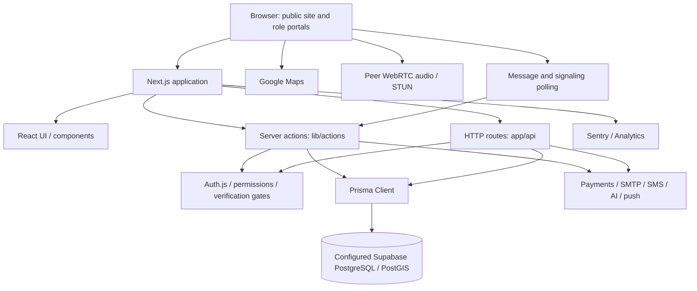

> Historical snapshot. For the current implementation and outstanding validation, see [Implementation status](IMPLEMENTATION-STATUS.md) and [Deployment](DEPLOYMENT.md).

# SAJI stack, architecture and GitHub ownership

9 October 2026. Source inspection: D:\OLIVER\MAIN, commit 3ad9644eedcb1749550ef55a87bb4565af6e636f, 92 reachable commits. Four tracked POS files have local changes and one manual SQL file is untracked. Live deployment, database contents and service availability were not tested.

## Technology stack

Versions are package.json declarations; ^ indicates a range, not an exact deployed version.

| Layer | Technology | Evidence |
|---|---|---|
| Framework | Next.js 16.0.10 App Router | package.json, app/ |
| UI | React / React DOM 19.2.0 | package.json |
| Language | TypeScript ^5; lockfile references 5.9.3 | package.json, pnpm-lock.yaml |
| Styling | Tailwind ^4.1.9, PostCSS ^8.5 | package.json, postcss.config.mjs |
| Components | Radix/shadcn-style UI, Ant Design 6.1.4 | components.json, components/ui/ |
| Forms | React Hook Form ^7.60.0, Zod 3.25.76 | package.json |
| Backend | Next.js server actions and HTTP route handlers | lib/actions/, app/api/ |
| Authentication | Auth.js / NextAuth 5.0.0-beta.31, Prisma adapter 2.11.2, JWT sessions; credentials and conditional Google OAuth | auth.ts |
| ORM | Prisma / Prisma Client 6.19.3 | lib/db.ts, package.json |
| Database | PostgreSQL configured on Supabase, PostGIS SQL | prisma/schema.prisma, .env.example, lib/geo-sql.ts |
| Payments | M-Pesa Daraja, Stripe SDK ^12.0.0, PayPal REST | lib/actions/payments.ts, app/api/payments/ |
| Mapping | Google Maps, @react-google-maps/api ^2.20.8 | lib/google-maps.ts, package.json |
| Messaging | SWR ^2.4.2, five-second database polling | lib/hooks/useConversationMessages.ts |
| Calls | Browser WebRTC, database-polled signaling, Google STUN; no TURN in inspected hook | lib/hooks/useVoiceCall.ts, lib/actions/calls.ts |
| AI | Google GenAI ^2.19.0, Anthropic ^0.111.0, configured provider fallback | lib/ai/ |
| Notifications | Nodemailer ^7.0.13, Infobip 2FA, web-push ^3.6.7 | lib/email.ts, lib/sms.ts, lib/push.ts |
| Monitoring | Sentry ^10.65.0, Vercel Analytics 1.3.1 | config files, app/layout.tsx |
| Charts/PDF | Recharts 2.15.4, jsPDF 4.0.0, AutoTable 5.0.7 | package.json |
| Dependencies/runtime | pnpm lockfile format 9; Node.js runtime | pnpm-lock.yaml, package.json |

Local command execution reported Node 24.13.1; production Node and pnpm versions are unverified. LiveKit dependencies are declared, but the inspected call implementation uses WebRTC directly. Installed dependencies do not prove a deployed LiveKit service.

The source has 138 Prisma model declarations and 156 files in lib/actions/. This does not independently verify 138 live tables. PostgreSQL 17.6, 431 indexes and five deployed GiST indexes remain earlier reported numbers.

## Where it lives

| Component | Location | Separation |
|---|---|---|
| Git repository | https://github.com/OliverYoung-dev/SAJI-3.git | Personal namespace, verified local origin |
| Customer portal | app/customer/ | Same Next.js application |
| Provider/shopkeeper | app/(pro)/provider/, app/(pro)/shopkeeper/ | Shared route-group layout; (pro) is absent from URLs |
| Other portals | app/distributor/, app/agent/, app/secretary/, app/sub-admin/, app/admin/ | Role routes, not separate deployments |
| Public site/storefront | app/page.tsx, app/p/[slug]/ | Same application |
| Shared frontend | components/, hooks/, lib/hooks/, styles/, public/ | Shared components/assets |
| Business backend | lib/actions/, lib/*-core.ts | Server code inside application |
| HTTP API | app/api/ | Auth, payments/callbacks, cron, receipts, subscribers, health |
| Auth/access | auth.ts, middleware.ts, lib/verification-gate.ts | Shared auth; server-operation coverage needs review |
| Database definition | prisma/schema.prisma | Code in Git; data in separate PostgreSQL service |
| Schema operations | prisma/migrations/manual/ | README states db push is used; SQL files are records, not automatically replayed migrations |
| Operations | scripts/ | Backfills, seeds, PostGIS and maintenance; some mutate data |
| Configuration | local .env, .env.example | Credentials were not read or copied |
| Hosting | next.config.mjs, vercel.json | Standalone targets self-hosting; comments mention cPanel/Passenger and HostPinnacle. Vercel cron/region config remains. Active host unverified |
| Storage | Supabase public email-assets URL in lib/email-templates.ts | Confirms a referenced logo asset, not the storage strategy for all uploads |

Frontend and backend are separated by runtime and files within ONE deployable application. PostgreSQL and external services are separate. No separate backend repository or persistent application WebSocket server was established.

## Architecture

Relationships show code/configuration, not tested live connectivity.

## Handover findings

- README still describes a frontend-only prototype; current server-action/Prisma code contradicts it.
- next.config.mjs ignores TypeScript build errors; build success alone cannot establish type correctness.
- scripts/prepare-standalone.js is empty (zero bytes), although postbuild invokes it. Deployment packaging needs verification.
- vercel.json contains three cron schedules; self-hosting needs an equivalent scheduler with CRON_SECRET.
- No .github directory or conventional automated test suite was identified in filename searches.
- .env.example is present locally but not tracked. .gitignore excludes .env*. Add an explicit exception only for a sanitized template.
- Payments and AI contain unconfigured/simulation paths; demonstrations do not establish live settlement or provider availability.

## SAJI-owned GitHub structure

Use a business-owned GitHub ORGANIZATION with individual member accounts. Organization name availability and owners still need confirmation.

Suggested structure:

- <SAJI-ORG>/saji-frontend: target repository for the Next.js web application and role portals.
- <SAJI-ORG>/saji-backend: target repository for the API, business logic, database schema and integrations.
- <SAJI-ORG>/saji-platform: transitional home for the existing repository and preserved history while extraction proceeds.
- <SAJI-ORG>/saji-infrastructure: optional later, when actual deployment/IaC automation exists.

The agreed future direction is separate frontend and backend Git repositories communicating through APIs, with independent deployments. The current application remains coupled through server actions, shared types and auth; extraction is a planned engineering change, not a separation already present. Transfer the existing repository into SAJI ownership as a transitional step, then migrate modules incrementally.

Have two business-approved organization owners; assign engineering, developer and reviewer access through teams. See GitHub repository roles: https://docs.github.com/en/organizations/managing-user-access-to-your-organizations-repositories/managing-repository-roles/repository-roles-for-an-organization

## Migration sequence

1. Confirm organization name, authorized owners, privacy and plan; verify required private-repository protections are available.
2. Review and preserve local uncommitted work. Repository transfer only moves remote committed history.
3. Inventory collaborators, rules, deploy keys, secrets, webhooks and deployment integrations. Maintain secure Git and database backups outside the repo.
4. Authorized admin transfers OliverYoung-dev/SAJI-3 through repository Settings; optionally rename to saji-platform. Transfer preserves history and associated repository resources. Recheck access afterward.
5. After destination confirmation, update checkouts: git remote set-url origin https://github.com/<SAJI-ORG>/saji-platform.git . Verify fetch/push. Avoid recreating the old path, which can break redirects.
6. Reauthorize hosting/GitHub Apps for the organization; validate deployment branch, environment configuration, callbacks and scheduled jobs.
7. Transfer or establish business ownership of Supabase, hosting, DNS and external service accounts separately. GitHub transfer does not move those assets.
8. Add CI, review rules, code ownership and sanitized setup documentation. Keep destructive schema operations out of automatic CI.
9. Validate staging authentication, database connectivity, sandbox payments and portal workflows before production handover.

GitHub transfer documentation: https://docs.github.com/en/enterprise-cloud%40latest/repositories/creating-and-managing-repositories/transferring-a-repository . Secrets, deploy keys and webhooks remain associated after transfer, so inspect them rather than assuming a clean ownership reset. Plan changes can affect protected branches and other features.

No transfer, rename, remote change, deployment or service-account change was performed.

## Still needed

Destination GitHub organization URL/owners; active production URL and host account; Supabase project/region/owners/backups; real upload storage; registrar/DNS ownership; production runtime; service-account ownership and environment status for OAuth, Maps, payment gateways, email, SMS, AI and monitoring. Obtain dashboard evidence without publishing credentials.

## Agreed future architecture: separate repositories and APIs

Target flow: Browser -> Next.js frontend -> versioned backend API -> Prisma -> PostgreSQL/PostGIS. Payment providers, AI, email/SMS, scheduled jobs and payment callbacks connect to the backend. The frontend has no direct database access or payment-provider secrets.

| Responsibility | saji-frontend | saji-backend |
|---|---|---|
| User experience | Role portals, React components, styles, browser hooks, static assets | API responses and business rules |
| Existing code | app pages/layouts, components/, client hooks | lib/actions/ business logic, core modules and relevant app/api/ handlers |
| Data | API client, cache, loading/errors and form state | Prisma client/schema, migrations, transactions and authoritative validation |
| Authentication | Login interface and client session state | Authoritative identity, session/token validation and authorization |
| Integrations | Browser Maps and permitted public configuration | Payments/callbacks, AI credentials, email/SMS and private integration keys |
| Operations | Frontend build and deployment | API deployment, scheduler, database changes, health checks and monitoring |

Next.js can remain the frontend framework. The backend framework is not yet selected; document that decision after reviewing runtime and deployment requirements. Separate repositories do not require converting the backend into microservices.

### API boundary

Define an OpenAPI contract for /api/v1 before extraction, including requests, responses, pagination, validation errors and authentication. Domain areas include accounts, profiles, discovery, jobs, orders, messaging, wallets/payments, POS, verification and administration. Keep permission and verification checks on the backend for every sensitive operation. Financial operations require transaction consistency and idempotency; clients cannot authorize settlement themselves.

Choose the browser authentication model deliberately: secure cookie sessions or a defined token flow, including expiry, revocation and OAuth callbacks. If frontend and backend use different origins, specify CORS, cookie scope and CSRF protection. Moving Auth.js is an architectural decision because its existing adapter and callbacks directly use Prisma; it cannot simply remain unchanged in a database-free frontend.

Publish versioned API schemas or a generated client consumed by the frontend. Shared types must not require frontend imports from backend source. Keep API changes backward-compatible during separate releases. Messaging can initially retain polling through API endpoints; WebSocket support is a separate future decision. WebRTC signaling moves behind authenticated backend endpoints, with TURN requirements assessed independently.

### Extraction sequence

1. Preserve the original Git history and define repository ownership, independent CI pipelines and staging deployments.
2. Inventory server-action consumers and define API contracts and authentication boundaries. Establish behavior checks for authorization and core financial workflows.
3. Create the backend foundation with configuration, logging, health checks and exclusive database/schema ownership. Establish a reviewed migration baseline; existing manual SQL is not an automatic migration history.
4. Migrate a bounded read-only workflow, such as public discovery, and replace its frontend server-action imports with API calls. Verify pagination, location behavior and errors.
5. Migrate authentication and protected workflows in controlled slices; avoid introducing two conflicting account/session authorities.
6. Extract messaging, jobs/orders, POS and administration, preserving business validation and permission checks.
7. Extract payments, callbacks and scheduled jobs with provider sandbox tests, idempotency and reconciliation checks before changing live callback URLs.
8. Remove direct Prisma and private business/integration code from the frontend once all consumers use the backend. Update dependencies and environment templates for each repository.
9. Validate independent deployment and rollback, API compatibility and full staging workflows before production cutover. Retain a documented rollback path for each migrated module.

The split is complete when each repository builds and deploys independently, the frontend uses documented APIs, and only the backend controls persistence and sensitive business operations. Cost and schedule require the endpoint/consumer inventory and acceptance results; this document does not claim the split is implemented.
